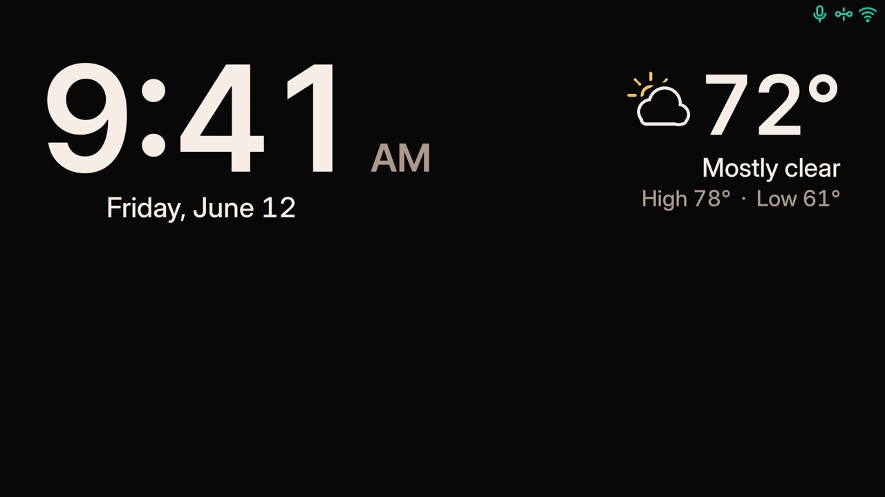
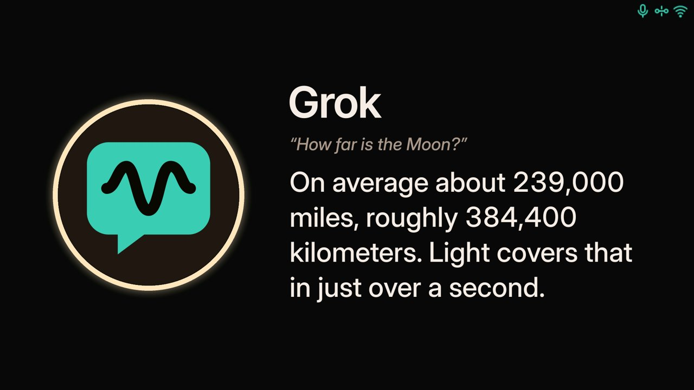
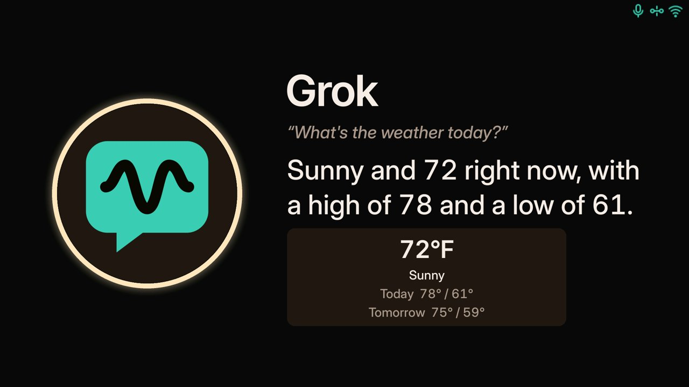
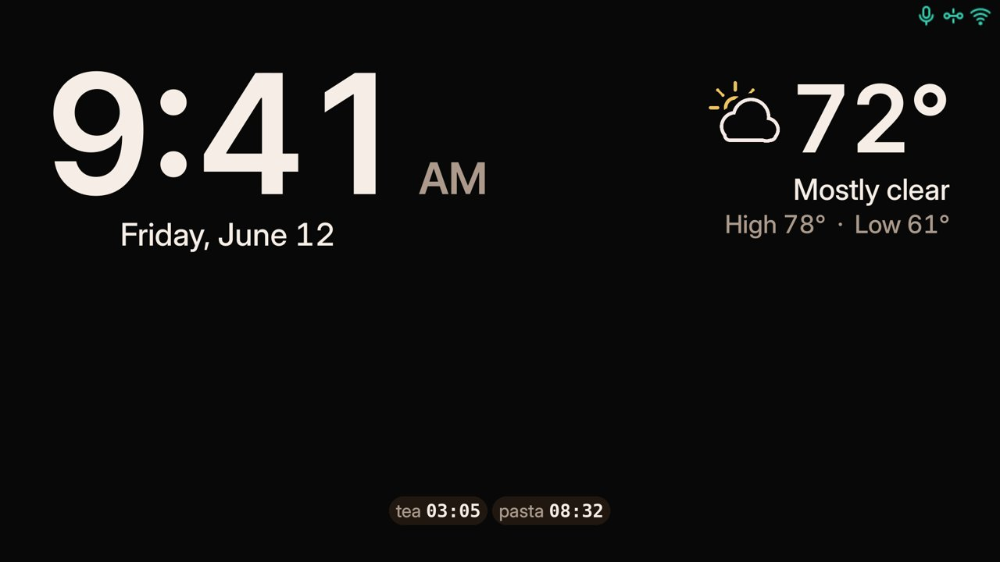
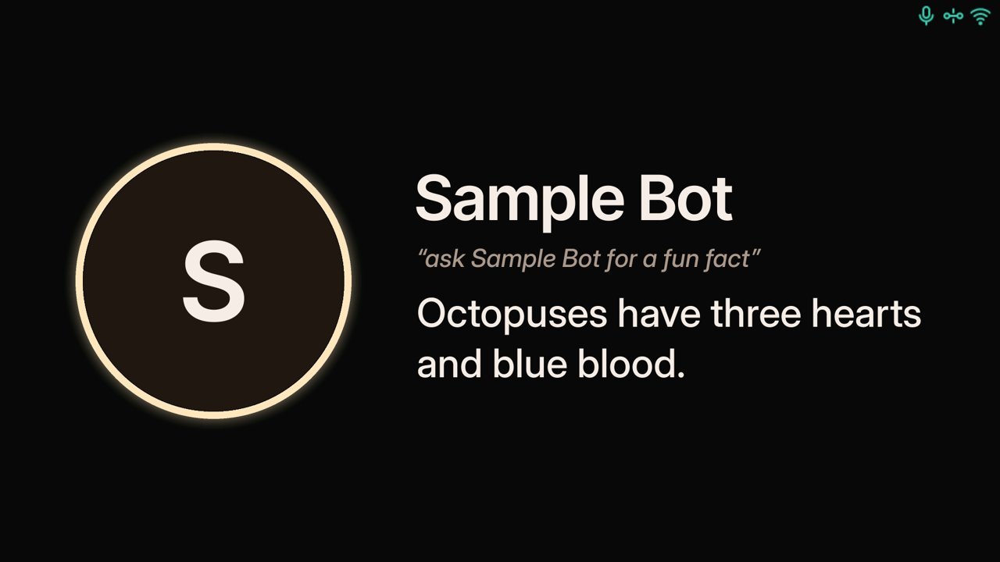

# grok-station

grok-station is a voice station you keep at home. It runs on a Raspberry Pi, listens for "Hey Grok", and shows the answer on its own screen. You set it up from a phone or laptop on your home network.

## What it looks like











## What you need

- A Raspberry Pi 4 with 2 GB of memory or more. A Pi 5 is the one to get. A Pi 3B is only for a small test.
- A display plugged into the Pi, from 800x480 up to 4K (3840x2160). See **Screens** below.
- Any USB speaker and microphone, or a combined USB speakerphone.
- A microSD card, 16 GB or larger.
- A power supply for the Pi.
- 64-bit Raspberry Pi OS Lite (Trixie).
- An xAI API key.

### Screens

The station draws straight to the Pi's screen, in landscape. Sizes from 800x480 to 3840x2160 fill the whole screen, and the layout scales to fit. Bigger screens get a centered 3840x2160 picture with black borders. Smaller ones still work, but things may not fit. The automated tests check layouts at 800x480, 1024x600, 1280x720, 1280x800, 1920x1080, 2560x1706 and 3840x2160. Not every size has been tried on a real screen. Portrait (rotated) screens are untested. Touch isn't used, so a touchscreen works as a plain screen. Small status icons in the top-right corner show the network, whether Grok can be reached, the microphone, and an update arrow only while a newer version is cached. The admin home has a Grok line: Online, No internet, Can't reach Grok, or Checking. Details are in [docs/display.md](docs/display.md).

## Put it on the Pi

In Raspberry Pi Imager, choose **Raspberry Pi OS Lite (64-bit)**. Set a hostname, Wi-Fi (or use Ethernet), and SSH. Write the card, boot the Pi, and sign in.

Then run:

```bash
wget -qO- https://raw.githubusercontent.com/bwilliam79/grok-station/main/bootstrap.sh | sudo sh
```

That checks the system, downloads grok-station, and runs `install.sh`. It does not ask questions. If you already have the files:

```bash
git clone https://github.com/bwilliam79/grok-station && cd grok-station && sudo ./install.sh
```

When a fresh install finishes, it asks you to press Enter to reboot. After that, the screen shows where to open the admin page and a short code. The full install, update, and fix-it notes are in [docs/operations.md](docs/operations.md).


### Or build a ready-to-boot card

`tools/build-image/build-image.sh` makes a card that needs **no network on the Pi**: boot it, join the station's setup hotspot, and set up Wi-Fi there. It runs this repository's own `install.sh` inside the image at build time (packages, Python, wake models), and the rest of `install.sh` offline on first boot, so it is the same install as `bootstrap.sh`. Updates come through the Updates page as usual. Full details and the per-OS steps: [docs/sd-image.md](docs/sd-image.md).

1. Push the commit you want. On Linux: `sudo apt-get install -y git curl xz-utils python3 e2fsprogs qemu-user-static binfmt-support`, then `sudo tools/build-image/build-image.sh --output "$HOME/grok-station.img"`. The image builds on Linux only (a Linux PC or a Linux VM you already have); no Lima, WSL or Docker.
2. Write the image with Raspberry Pi Imager (**Use custom**), balenaEtcher or `dd`.
3. Put in the card, connect the display and the USB speaker and microphone, and power on. No cable is needed.
4. The Pi expands the card and restarts, then shows "Getting Grok Station ready" and restarts again.
5. The screen shows the setup hotspot. Join it from a phone, open the address shown, set up Wi-Fi, and finish setup.

## First steps

1. **Wi-Fi.** If the Pi is not on a network, the screen shows a setup hotspot: a Wi-Fi name, a password, and a page to open. Join that Wi-Fi, open the page, and join your home Wi-Fi. The hotspot then turns off, and the page moves to your home network.
2. **Sign in.** Open the address on the screen (`https://<hostname>.local`, or the address with the IP). The certificate is self-signed, so the browser warns you; continue past that. Enter the code from the screen, then choose an admin password. There is no username.
3. **xAI key.** Paste your xAI API key and save it. The page will not show the key again. Voice starts once it is saved.
4. **Add your main bot first.** A computer on your home network must be running the Grok Bot app, and be on and reachable 24/7, for replies to reach the station.

## More detail

- [What runs on the Pi](docs/architecture.md)
- [Install, update, and troubleshooting](docs/operations.md)
- [Connecting a bot](docs/bots.md)
- [Recording a wake word](docs/enroll.md)
- [Versions](docs/versioning.md)

Other notes in `docs/` cover the design, handoff between bots, and longer plans.

**0.13.9** The Bots page no longer shows the bot count line above the list (screen readers still hear "Bots, N"), so the list starts higher. The "Added a bot? Say Hey Grok, update my team list." tip moves from a card above the list into a Voice tip button in the Bots header (an icon button on phones) that opens it in a small popover (on phones, a sheet with a Close button); Esc, a tap outside, moving focus away or the button closes it. The page also gets a Set up bots list. When bots aren't connected yet, a callout says how many ("1 bot not connected" or "N bots not connected") and its Configure all or Set up <bot> button opens one list with a row per bot. Before anything is sent, that button only opens the list and goes away once it is open. After the first setup is sent, it reads Show list or Hide list; the list starts open only while a row needs you (not set up, failed, or sent with no OK card yet), and your choice holds until the page reloads. Each row has a fixed height, a status chip and one tappable message line; Setup steps shows exactly what your main bot passes on, and you can edit the name, wake word and computer before sending. Send setup goes only through your main bot, which shows you a confirm card first; if your main bot is out of date, the page asks you to update it first. A send that fails stays on its row until one succeeds. The station's wake-word training tile no longer draws any buttons: before recording it shows "Starting in a moment…", and if training fails it says to try again with "Hey Grok, train my wake word for <bot>" and closes after 10 seconds. While training, the tile keeps "Say “Hey <bot>”" as its heading the whole time, with the status (get ready, the countdown, listening, clip saved) on the line under it. If a clip is silent, the tile says "I didn't hear it. Stopping in 3…" and counts down; make any sound and it tries that clip again, or stay quiet and it stops with "Stopped. Nothing was saved." (the tile hint now says "To stop, stay quiet for 3 seconds."). On the WLED and Homebridge pages, the way back to Integrations is now a button at the top left. The System page is grouped into Status, Password and security, and Troubleshooting sections you can open and close, with Reboot station and Run setup again in a Danger zone at the bottom. If the microphone gets stuck giving only silence, the station now resets it by itself after about a minute (when automatic mic resets are on), instead of waiting for you to unplug it. "Train my wakeboard for <bot>" (how the transcriber often hears "wake word") now starts training too. Admin sign-in: when "Ask for the password again" is set to "Not while I'm signed in", the sign-in no longer expires after 30 minutes idle or 12 hours; it lasts until you sign out or the password changes, and the page shows no "Unlocked for" countdown. The other choices keep the 30 minute idle and 12 hour limits. A new "Sign out everywhere…" row at the bottom of System > Password and security ends every admin sign-in, this one included, after a confirm. In that mode, only a password change or a factory reset asks for the password; in the other modes, turning privacy mode off, changing this setting and turning on WLED Voice home control still ask. A password change or reset also signs out every browser. The System status list shows "unknown" for a service whose state can't be read. The failed training tile names the bot by its display name (for an unnamed wake word, "for Nova", not "for Hey Nova"). Press Update on each bot from the Bots page after installing (only the release number in their instructions changed).

**0.13.8** Saying "Hey Grok, train my wake word for <bot>" now starts training on its own: the station says how it works once, shows "Recording in 3…" with a 3-2-1 on screen, chimes, and records five clips, saving each one and moving on after a short pause. If the bot already has a wake word, the same sentence adds five more. Pressing Record voice gets the same 3-2-1. The station tiles have no Cancel or Close button (the station has no touch input); while recording, the tile says "To stop, stay quiet." If a clip is silent the station asks once more; a second silent clip stops training and keeps nothing new. Anything said while a clip is recording is never taken as a command, and there is no spoken cancel between clips. The mic icon no longer stays stuck on a problem after a microphone reset. The Grok status icon is centred with the mic and Wi-Fi icons. On the Bots page, Update all appears in a callout above the bot list only when bots need it (the Configure all callout waits for 0.13.9); Refresh avatars and Revoke all bots move to a ⋯ menu next to Add bot. A bot's message replaces its "Replies from" line as a one-line button; tap it for the detail (a sheet on phones) without also opening Configure. The WLED and Homebridge pages get a plain back link to Integrations, and their Remove buttons move to the bottom of the page. On the System page, "Ask for the password again" offers Every time, After a set time (1 to 120 minutes, default 10) or Not while I'm signed in. That last choice still ends after 30 minutes idle, 12 hours, sign-out or a password change, and changing the password, resetting the admin login, changing this setting and turning privacy mode off always ask (0.13.9 changes this for "Not while I'm signed in"; see above). A factory reset puts it back to 10 minutes. Press Update on each bot from the Bots page after installing (only the release number in their instructions changed).

**0.13.7** Training a wake word no longer listens for a spoken "stop": the small speech recogniser is gone, and Install or Update removes its 40 MB download from the station. Training still ends on its own (by clip count, after 2 minutes waiting, after a 10-minute pause, or after 30 minutes) and with the Stop button on the tile. Saying "Hey Grok, train my wake word for <bot>" no longer closes the training tile with the hang-up tone a moment after it opens. A connected Homebridge on your home network now shows its address under "Connected" with a small "http ⓘ" label; tap it for a short note on why that is fine at home. Adding Homebridge devices is shorter: when none of the names clash, Pick devices saves straight away with the Homebridge names. When a name sounds like a bot, a command word or another device, a Voice names step shows just that device, says what it sounds like, and offers a box for a new name with a suggestion; the card turns to a check once the name works. The other devices can be renamed under "Rename others", each with up to three extra names it also answers to. The station now accepts only PNG, JPEG and WebP portraits. The wake listener's Python environment moves to a folder only the system can change. The picture library that reads bot portraits, the relay's cryptography library and the bot computers' PyNaCl are updated to versions with known security problems fixed. Bots that keep their key on your own computer show "Helper out of date" until you press Update, which installs the new PyNaCl there. Press Update on each bot from the Bots page after installing (only the release number in their instructions changed).

**0.13.6** Two safety fixes, nothing to see on the screen. Only one update runs at a time on a computer, even when two bots start one together; it now uses the system's own file lock, which clears itself if an update is killed. The installer refuses to set up the wake listener's folders if one of them has been replaced by a link to somewhere else, instead of handing that place to the listener's account; the same check now covers the folders and files an Update writes for the listener, the wake-word upload folder, the relay's voice folders, the cleanup of retired wake-word settings, and `sudo grok-station reset-admin`.

**0.13.5** Train a bot's own wake word from the station or the Bots page. Say "train my wake word for <bot>" or press Train wake word on the Bots page (it asks for your admin password first) and a training tile opens at the bottom of the screen. Saying "stop" while it is recording, between clips, or while the tile is waiting ends training and deletes that session's clips; tapping the tile still works the same way. Training also ends on its own: the waiting tile closes after 2 minutes if you don't start, a pause longer than 10 minutes discards that session's clips, and a whole training session ends after 30 minutes however often it's paused. "Stop" is heard by a small speech recogniser that runs only on the station: it listens only during training, only for that one word, and nothing it hears is saved, logged or sent anywhere. Install or Update downloads it once (about 40 MB) and checks it before use; if the download fails, training still works by touch. The station's internal training controls now need a private key that only the station's own services can read. Recorded clips stay on the station. When a new light's name sounds like one you already have, the Integrations page now says which one, for example "Sounds the same as “Bar lights” (WLED) when you say it. Pick a name that sounds different, like “Bar room light”." Adding Homebridge devices is less cramped: the Pick devices step shows Lights, Switches, Outlets, Fans and TVs as collapsed rows, each with one checkbox that selects the whole group, and the Switches row reminds you to check for locks or garage doors. Press Update on each bot from the Bots page after installing (only the release number in their instructions changed).

**0.13.4** The mic icon on the station no longer turns gray with a yellow slash while the speakerphone is working. In a quiet room the speakerphone can send pure silence, which makes the listener close and reopen the mic, sometimes waiting up to about 30 seconds between tries; the icon now treats that wait as normal. A missing speakerphone, a stopped listener, or a mic that stays closed past the wait still shows the problem. Adding Homebridge no longer shows the turn-on-accessory-control screen when accessory control is already on but the accessory list is large (a few dozen plugs, light strips and cameras easily pass the old 64 KB limit). The station now accepts an accessory list up to 2 MB and gives that call 10 seconds from connecting to the last byte (other Homebridge calls get 5 seconds); a Homebridge that answers too slowly, even a byte at a time, is cut off and treated as not answering; the accessory-control screen appears only when Homebridge itself says insecure mode is off. A list over 2 MB gets its own Verify screen, "Homebridge has too many accessories to share", with steps to trim it; the login stays saved and Try again checks again. The http notice in the Homebridge setup is now a calm information box ("Not encrypted.") instead of an amber warning. The "Use Homebridge for these devices. Apple Home has no API outside Apple devices." note at the bottom of the Integrations page is gone. Press Update on each bot from the Bots page after installing (only the release number in their instructions changed).
**0.13.3** Adding Homebridge no longer sends you back to the address step when the login works but Homebridge won't list its accessories. A new screen says to turn on accessory control (Settings, then Startup & Environment, Enable UI Accessory Control) and restart Homebridge; the login is kept in memory for 15 minutes so Try again finishes without retyping it. If Homebridge stops answering while signing in, you stay on Enter login with your entries kept. Press Update on each bot from the Bots page after installing (only the release number in their instructions changed).
**0.13.2** The station screen has a new Grok icon in the top-right corner, in the old relay icon's place: teal when Grok can be reached, amber with a slash when the internet is down, amber with an "!" when the relay or the Grok service can't be reached, a muted bubble with a small arrow while it checks, and dimmed when the network itself is down. The admin home shows a matching Grok line (Online, No internet, Can't reach Grok with relay or service, or Checking). To decide, the station opens a plain connection to 1.1.1.1 (or 8.8.8.8) on port 443 and makes an unauthenticated request to api.x.ai, about once a minute while things are fine and every 12 seconds while something is wrong; no key or personal data is sent. Voice hints on a recipe step, a ringing timer and the calendar footer now share one style: muted "Say", the spoken words in white inside curly quotes. Press Update on each bot from the Bots page after installing (only the release number in their instructions changed).
**0.13.1** Homebridge on the Integrations page: type the Homebridge UI address (for example `http://homebridge.local:8581`), open Homebridge's Users page from the button, make a user named `grok-station` with Admin left off, then enter that login. The station checks three things (it is the Homebridge UI, the login works, the login is not an admin) and refuses an admin login outright. Lights, switches, outlets, fans and TVs (on/off only) can be added; cameras, doorbells, sensors, locks, garage doors and thermostats are never listed. Say "turn off the porch light" as with WLED. One **Voice home control** switch now covers WLED and Homebridge together (off until you turn it on with the admin password). The login is stored only on the station, readable only by the relay, and Remove Homebridge deletes it with no copy left. An http:// address works, but the login and its sign-in token then cross your home network unencrypted, and the page says so; turn on https in Homebridge's UI settings and use the https address if you can. A Homebridge login with 2-step sign-in is refused at Verify; make the grok-station user without 2-step. Bots can now look up your calendar, reminders or the weather to answer a station question (read-only; they still never run anything written in the question). Every bot row on the Bots page is the same height, with at most one short status line (full text on hover). "Hey Grok, …" examples read as one line, and the Integrations back control is a plain button. Update each bot from the Bots page after installing.

**0.13.0** New Integrations page (under More on a phone) for WLED lights: find them on the network or type an address, name them, and say "turn off the porch light", "set the porch to 40 percent" or "set the porch to blue". The station plays a short tone for done or failed instead of speaking, and opens no new port. Voice control of the lights is off until you turn on **Voice home control** under Integrations › WLED › Manage (it asks for the admin password; saving a light never turns it on). While it is off, a light command gets one short spoken line saying so. "Turn off the lights" with no name is not handled yet. A bot's voice is filled in from the bot's own settings when you haven't picked one; a voice you picked is never changed, and Add bot still has the picker. Bot Test gives up at exactly 30 seconds, and its result updates the bot's ring and status right away. The status moved from under the bot's name into the picture's tooltip ("Offline: <reason>"; tap on a phone). The active-bot tile on the display has no state word. A bot that says "one moment" first and answers after is now heard in full. Input borders and faint text in the admin are easier to read, and voice names show capitalised (Aurora). A bot answer the station blocks (personal info with the PII filter on, or something like a secret) now ends the wait at once with a short message on the display, and the helper says why. A wake word that sounds like another bot's is a warning you can accept, with suggested alternatives; an exact duplicate is still refused. Home bots get a new station helper (0.13.0). Update each bot from the Bots page after installing.

**0.12.17** Bots keep the "Which home computer" paragraph after an update (it was only in the first-time setup text). The setup reply links straight to the routine's Webhook URL and Webhook key fields. Update each bot from the Bots page after installing.

**0.12.16** Score and calendar tiles, and the bot's listening, thinking and replying states, use the empty bottom part of the main screen; the clock, date and weather stay put. While a tile is up the bot's status moves to the upper left. Recipes stay full screen, and a tile that arrives during one is a chip by the clock ("dismiss" clears it). Long replies scroll in a 4-line window as they are spoken. See [display.md](docs/display.md#bottom-zone-01216). Bot avatars on the Bots page no longer flicker every few seconds. A new bot is asked for its picture right after its first passing test, and each bot sends its own picture file (`avatar-<slug>.png`), never a shared one.

**0.12.15** If the station's helper status file is ever damaged, every bot paired at that moment shows "Helper version not confirmed: use Update" until it confirms its helper, so one bot posting no longer hides the others. The "Helper status unreadable" banner stays until they all have, or until you press Hide warning. No copy of the damaged file is kept. Bots don't need an update for this release. **0.12.14** A bot whose helper sends a broken version, or that once replied without one, keeps showing "Helper version not confirmed: use Update" until a signed version confirms it. If the station cannot read its helper status file, the Bots page says "Helper status unreadable" instead of quietly hiding warnings, and the file is replaced on the next bot post. Bots don't need an update for this release. **0.12.13** A bot running a very old station helper (one that never reports its version) shows "Helper version not confirmed: use Update" after its first reply, and the Bots menu dot counts it. A bot you just added still shows nothing until it has replied. A signed helper version now always wins over the unsigned one. Bots don't need an update for this release. **0.12.12** Right after Add bot, a bot no longer shows “Helper out of date” for a few seconds: the warning appears only when the bot has reported a helper version that is older than the station's. A voice question turned away by a daily limit no longer cancels a running Test. Bots don't need an update for this release. **0.12.11** Voice questions are no longer refused because the Bots page was testing bots: the page sends no automatic test questions, and a voice question cancels a running Test. When a bot is busy the station says it is still working instead of "a lot of questions today". The thinking tone is a soft low pulse (the old chime is an option on Audio). Score tiles show right away with logos filling in, and leave after 15 seconds. Home bot instructions run the helper by full path, so bots need an update after this release. **0.12.10** Bots are flagged for an update only when what they run changed, not every release. The Finish update button is gone from the Updates page; update bots from the Bots page. Bots in the menu gets an update dot while a bot needs one, and after a station update a short notice points you to Bots. With only your main bot, the Bots tip says “Hey Grok, import the rest of my team.” **0.12.9** The computer name is kept exactly as the bot sends it (for example `name.local`); the Bots page only shows the part before the first dot. A bot you delete and add again is no longer flagged as needing an update. Update and Update all on the Bots page update the bot in place with a small spinner instead of opening Finish update, and show why if it fails. **0.12.8** Add bot and Change computer ask for the computer's name exactly as it shows in the Grok Bot app, not a hostname. A bot you just added is no longer flagged as needing an update. A bot that does need one has an Update button on its Bots row, and Update all appears on the Bots page when any bot needs one; both use Finish update. **0.12.7** A bot has about 3 minutes to answer. After a few seconds the station says "Checking, one moment." and the waiting ring stays. An answer that arrives after you have moved on is still spoken when the station is free, with the bot's name first. Recording a wake word takes 5 tries, and Train more adds 5 more. A word already made from 10 recordings still works. While the station is thinking, a soft chime repeats until speech starts. It waits a moment so a quick answer stays silent, uses the station speaker, and is quieter at night or when the screen is dim. Audio has a Waiting tone switch, on by default. While a recipe is up, “next step”, “back”, “repeat”, “start over”, and “done” are handled on the station and read aloud; a question that only contains those words still goes to the bot. The station caches ESPN team logos itself when it accepts the card (about a second, then an abbreviation if one is missing). A reply waits briefly for a card from the same persona so the text does not flash first; speech is not delayed. A new score, recipe, or calendar replaces the previous one, and it returns to the clock about a minute after the conversation goes idle (a recipe waits longer) even when `ttl_s` is much longer. On a sports card each team's logo sits centered above its name. No logo, or a logo that does not load, is just the name. Copying the one-time "Deploy bot key setup" instructions and pasting them to the bot is the approval, so the bot runs that setup without asking again. It is still one time, on the home computer that stays on, and the station still never pushes code. Finish update is only on the Updates page (not the page header). A bot row links there when that bot still needs the update or its helper is behind, and the count includes only bots still on the list. The Bots page tip says to add a bot when you have no main bot, “Hey Grok, import my team.” before an import, and “Hey Grok, update my team list.” after one. That update phrase imports only bots that are not already there. “Import the rest of my team” still works when you say it. The Bots list has a Wake word column: quoted, no comma, with the on/off switch after the phrase. Hey Grok no longer shows an Always on pill. Each bot on the Bots page has a ring on its picture: teal when it is online, red when it is offline, and gray while the station is checking. The page checks every bot when you open it and about once a minute after that. The Online and Checking pills are gone; an offline bot still shows the reason in amber. On Connect webhook, Copy instructions stays highlighted until the webhook URL, webhook key, public key, and home computer name are filled in, then Next turns on. Back goes to the previous step. Copy says Copied on the button for a short moment. **0.12.6** The mic icon no longer shows a false problem during long conversations or wake-word training, and the first mic stall reopens after 2 seconds. Team logos download over IPv4. A score, recipe or calendar tile stays up during a conversation with a small badge showing the bot. Finish update is tidier and waits 10 minutes for each bot's reply. A second bot on the same home computer reuses the installed helper. New avatars show without a reload, bots report the computer name they can see, and Refresh avatars sits beside Add bot. **0.12.0** Saying just "goodbye", "stop", "never mind", "cancel" or "that's all" ends the conversation right away on the station for every bot's wake word, with no bot call ("stop" still silences a ringing timer first). "Hey <bot>, import the rest of my team" works through any bot. Deleting a bot removes it everywhere on the station, including its row in the imported team list and its avatar. A score or other full-screen tile a bot sends shows alone as soon as it arrives and goes back to the clock when speech ends or after the Score card hold (Display page, default 10 s), whichever is longer. Sunrise dimming always uses the Time and location setting (the separate latitude and longitude fields are gone), and the offsets show "min". Password failures say "Password incorrect.". Every copy button for bot instructions has View instructions beside it, the bot's voice saves as soon as you pick it, the tab is "Voice and avatar", wake phrase actions are real buttons ("Remove phrase"), and the admin uses one type and spacing scale (docs/design.md 3.3).

**0.11.9** Finish update checks a bot's new instructions against the template from the same release on main (its checksum must be in that release's list), so wording changes ship without a script change; the parts that may vary stay fixed in the pinned script. Add bot and More copy use the station's own address, the same one Finish update uses, not the address in your browser. Review fixes: a release whose list has no template is refused instead of using a built-in copy; every template must keep its safety lines; the computer id a bot reports is keyed to your station; two updates on one computer can no longer race for the lock. **0.11.8** Finish update. After a station update, an amber Finish update button (page header and Updates page) opens one dialog that lists each bot by computer and updates them in one click: each bot runs one pinned update script that checks the commit is on the project's main branch, refuses an older or same release, checks every file's sha256 against the release manifest, keeps keys and config, and only accepts instructions that match the fixed template. A row turns green only when the bot's signed reply names the exact instructions the dialog showed; red means the bot refused. Bots set up before 0.11.8 need one last paste (Copy in the dialog). The first bot on a home computer updates the shared helper for the rest (Use another bot picks a different one). One ask per bot every 10 minutes. The Bots-row Update helper button is gone. See [docs/bots.md](docs/bots.md). Also in 0.11.8: adding a bot runs the same connection test as Test; the row shows Checking connection… until it answers, then Online, or Offline with the reason, and a passing test quietly asks the bot for its picture, which swaps in when it arrives. A bot's own wake word (Hey Kai) goes straight to that bot with no Asking announcement. Bots whose key is on a home computer can now put display cards (score, recipe, calendar) on the screen with `gs-seal-reply show`; before, their instructions said to skip cards, so a score came back as speech only. The home helper is now 0.11.8; Finish update installs it. Review fixes: bot instructions must now match the fixed template byte for byte (printable ASCII only, every line checked, only the bot id and station values may vary); a stale update lock (dead process or over 15 minutes) is cleared; a damaged release record no longer blocks an update; the station address in instructions comes from the station itself, not the browser; the release check confirms every pinned commit is on main. **0.11.7** Bots that reply from a home computer show Helper out of date when their station helper is behind, with an Update helper button (the bot runs the station's pinned installer in a new update mode that keeps its key and pairing; a copyable command is the fallback). A deleted wake word no longer comes back a minute later. The setup wizard no longer has a Wake words step; set wake words per bot on the Bots page. **0.11.6** Ask bot for picture now waits up to about 2 minutes and says whether a new picture arrived, the bot didn't send one (its station helper may be out of date), or the bot couldn't be reached. The Configure tab row no longer shows a stray vertical scrollbar. **0.11.5** After an update the admin page waits until the station answers again (up to about 90 seconds, showing Reconnecting…) before it reloads, and a page that loaded while the station was down redraws itself once it is back, unless you are typing in a field or have a panel open. **0.11.4** Configure is four tabs (Wake word, Voice and photo, Connection, More) with one main button per wake-word state, the webhook fields under Edit connection, and Delete bot last under More. Bots send their own profile picture: the routines say to send it once after pairing, and Ask bot for picture asks again. Deleting a wake word removes every recording, its model, and its row, and deleting one that is already gone still succeeds. See [bots.md](docs/bots.md) and [enroll.md](docs/enroll.md). **0.11.3** Wake word and Display fixes. Train more leaves the not-good-enough screen as soon as it starts, recording shows only the per-recording check marks, the training dialog has one Close, and the pass line is 80% of the test clips ("It needs 24" for 30). The recording count skips empty, unfinished, and duplicate sessions. Display fits one desktop screen: settings on the left, both previews on the right. A saved town or ZIP shows in the accent color with a pin. Hey Grok uses the station logo. See [enroll.md](docs/enroll.md) and [display.md](docs/display.md). **0.11.2** Admin layout. The security certificate shows SHA-256, the fingerprint, and copy on one row. On Bots, Revoke all bots sits next to Add bot, and an empty list is the line "No other bots yet. Hey Grok always works." Audio is tighter, and Play test sound sits next to the speaker. Display is grouped into Clock and night clock, Screens, Brightness, and Units, with team logo sources at the bottom. Night clock hours and the dim window stay separate: the hours are the black clock when Brightness is Off, and Dim the screen from/until is when Schedule lowers the backlight. A saved town or ZIP shows as text with Change location. See [docs/display.md](docs/display.md) and [docs/bots.md](docs/bots.md). **0.11.1** The xAI key lives on the xAI API page under System (the old Voice address opens it). A bot added again with the same id reclaims its wake word, and a word whose bot is gone can be deleted under Unused wake words. "Hey Grok, import the rest of my team" asks the main bot for names; those names show as Not set up on Bots, and Copy team setup message copies one note for the main bot to send. The station sends nothing. The computer name is only the label from the Grok Bot app. See [docs/bots.md](docs/bots.md). **0.11.0** Home mode runs on macOS and Linux. Alpine (musl) is not supported. On Linux the key folder is tied to this computer's machine id, and it is marked with a cache-directory tag plus an empty `.nobackup` file so backup tools that honor those skip it. btrfs and snapper snapshots are not skipped. Python 3.14 is supported (cffi 2.0.0). Setup no longer needs pip. See [docs/bots.md](docs/bots.md). **0.10.3** Wake words live on the Bots page (the Wake words item is gone; #wake opens Bots). Hey Grok stays built in and always on. Configure sets a bot's wake word, trains more, or removes it; a removed bot's word stays under Unused wake words. Change computer asks for a name when the key is on the bot computer, and a home-computer key needs Replace key (a home-key bot that still has no computer name can set it). "Hey Grok, can you connect me with Kai" (also "connect me to" and "put me through to") is handled on the station: it says it is connecting you, switches the session to that bot, and the bot's first line is "Hey, this is Kai. How can I help you?" Follow-ups go to that bot until the session ends. See [docs/bots.md](docs/bots.md) and [docs/enroll.md](docs/enroll.md). **0.10.2** Bots show which home computer sends their replies ("Replies from: <name>"). Add bot asks your bot to pick the always-on computer and send its name back. When a reply doesn't come, the station says that computer may be offline. Configure has Change computer. See [docs/bots.md](docs/bots.md). **0.10.1** Fixes recording a wake word. A word recorded for a bot that had an old switched-off or deleted entry (like Hey Ash or Hey Rhea) was built but stayed off; recording it now turns it on. The recording dialog closes with Ready when the word is built, and shows a plain message if building fails or the station restarts partway. Unfinished words show in the list with Record voice and Delete. Building uses less memory. **0.10.0** Custom wake words work on the station itself: record a phrase 10 times on the Wake words page and the station builds it from those recordings, with no training computer. If it isn't reliable enough yet, the page says so and Train more records 10 more. Each word starts its own bot. Uploading a model trained on another computer still works as an advanced option. See [docs/enroll.md](docs/enroll.md). **0.9.4** Hey Grok is the only shipped wake word; updating removes the old starter models (custom trained or uploaded words are kept). Reach any bot with "Hey Grok, ask <bot>". **0.9.3** The card image builds on Linux only (a Linux PC or a Linux VM); the macOS (Lima) and Windows (WSL) build scripts are removed. **0.9.2** The card image needs no network on the Pi: install.sh runs inside the image at build time and finishes offline on first boot, and Wi-Fi is set up through the setup hotspot. Native build scripts for Linux, macOS (Lima) and Windows (WSL). The main bot has a gold star and is listed first. Wake words: every shipped model was installed (removed again in 0.9.4), training is a fixed 10 recordings per session with Train more, and wake words can be deleted. Team logos default to ESPN's logo CDN (a.espncdn.com). Bots can put display cards on the screen, and Configure has Copy updated instructions for bots already set up. **0.9.1** The card image builds again, needs no Ethernet (Imager or build-time Wi-Fi works), builds on macOS, Windows or Linux through Docker, runs the same `install.sh` as a normal setup, and shows "Installing Grok Station" on screen. See [docs/sd-image.md](docs/sd-image.md). **0.9.0** Add bot instructions include a one-time deploy step, "Deploy bot key setup on system running Grok Bot": the script installs the pinned programs on your own computer and on the home computer running Grok Bot when the key lives on the bot computer, or on the home computer when the key lives there. It asks before it runs. The station never pushes code or asks for those files again. After it runs, reply with the public key it printed, never the private key or the seed. Changing the key later means pairing again with Replace key. See [docs/bots.md](docs/bots.md). **0.8.5** "Bot computer" loses "(default)", and the home-computer speed note joins the 24/7 note under the choice (Add bot and bot settings). **0.8.4** plainer Add bot: the key step only asks where the key lives; the webhook step is required and collects the webhook URL, webhook key and bot public key; the instructions sit behind View instructions and Copy instructions; station key, fingerprint and technical notes are gone from the flow; README lists any USB speaker and microphone and the supported screen sizes (docs/display.md). **0.8.3** plainer Add bot key step (Bot computer or Home computer, one note on what must stay on) and a shorter setup prompt. **0.8.2** turns on home mode in Add bot as an opt-in choice; cloud stays the default. **0.8.0** ships the Mac home-mode scripts (`gs-seal-setup`, `gs-seal-reply`) with hash-locked PyNaCl. Add bot keeps offering cloud mode only until home mode's first validation run. See [docs/bots.md](docs/bots.md).

**0.6.0** adds bot list import, saves switches immediately (other fields keep a Save button), shows an add-bot routine to paste into the bot along with this station's certificate fingerprint, and leaves mic gain alone until that slider is moved. It also pins the wake packages (openwakeword 0.6.0, onnxruntime 1.31.0, numpy 2.5.4) and adds the peak sample and clipped ratio (`clipped=0.0012`) to the mic level line. Grok Bot on a home computer on the station's network posts replies. The key lives on the cloud computer (default) or, on a Mac, on that home machine (`gs-seal-reply`, one command, about 3 seconds faster; enabled in Add bot after its first validation run). A key exists on only one machine; switching mode revokes the pinned key. Add your main bot first. Notes are in [docs/versioning.md](docs/versioning.md).

**Cards.** A paired bot can put a recipe, sports, calendar, or home card on the display. It uses the same sealed signature as a reply, on `POST /voice/show`. See [docs/cards.md](docs/cards.md).

Never route the admin HTTPS port (which also carries `/voice/reply` and `/voice/show`) through cloudflared, a tunnel, or a router port forward.

Locked out of the admin page (for example, your computer is on a different subnet or a VPN)? SSH to the Pi and forward the admin port over loopback, for example `ssh -L 8443:127.0.0.1:443 <user>@<pi-address>`, then open `https://127.0.0.1:8443`. Loopback is always allowed. There is no config allowlist to edit.
